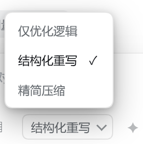

# dsh-prompt-boost

DSH Web GUI 的「增强提示词」插件：输入框工具栏加一个 **✦** 按钮和风格选择器，把当前草稿按所选风格重写成提示词，流式预览、确认后回填、可撤销，并带一个独立设置页。

## 功能

- **✦ 按钮**：位于输入框工具行、发送键左侧；空草稿或生成中自动禁用。
- **生成前选风格**：`logic`（仅优化逻辑，默认）/ `structured`（结构化重写）/ `concise`（精简压缩）三选一；选择结果记在本地，下次自动沿用，设置页可另设默认。
- **自定义提示词二选一**：设置里填写系统提示词后进入自定义模式，风格选择器禁用并提示，风格不再参与生成。
- **流式预览**：原文 / 增强后两栏对照，生成过程中边收边显示；生成期间可取消。
- **思考计时**：点 **✦** 后卡片右上角显示从点击到返回的耗时；失败或中断时冻结在发生时刻。
- **回填与撤销**：确认后写回输入框（`inputActions.setDraft`），并在输入框上方出现一条撤销提示，一键恢复原文。
- **设置页**：`设置 → 提示词增强`，保存后立即生效（宿主每次请求都读设置）。
- **安全边界**：空草稿、`/` 命令在本地拦截；失败只提示，不改动草稿；服务端二次校验长度与模型可用性。

## 更新说明

### 0.4.0（2026-10-29）

- 修复设置页系统提示词清空后被默认提示词自动回填的问题；清空状态在当前浏览器记住，`customMode` 语义不变。
- 增强卡片右上角新增思考计时：点击 **✦** 开始，结果返回、失败或中断时冻结。
- 调整卡片头部布局：生成中文案与计时同行，计时在右；窄宽度优先省略模型信息。

### 0.3.0（2026-10-29）

- 设置页「系统提示词」联动：`systemPrompt` 为空时显示当前默认风格的提示词；手动编辑后进入自定义模式，风格选择器禁用。
- 宿主 `GET /prompt-boost/settings` 的 `styles` 增加 `system` 字段；客户端直接使用宿主返回值，不再复制提示词常量。
- 「填入内置策略」按钮改为单行小字号，文字不再换行。



## 安装（本地 link）

```
plugin_manager install_bundle  target = link:D:/DeepSeek/dsh-prompt-boost
```

等价 CLI：

```
dsh plugin --profile desktop add link:D:/DeepSeek/dsh-prompt-boost
```

- 宿主半边改完可用 `set_plugin include:prompt-boost`（false → true）热重载，无需重启 DSH。
- 浏览器半边改完需要刷新页面。

## 使用

1. 在输入框写一段草稿（一句话也可以）。
2. 在 **✦** 左侧选择风格；没选过时使用设置页的默认风格。
3. 点 **✦**，等预览卡出现；生成中右侧会实时显示结果，卡片右上角显示从点击到返回的思考计时。
4. 满意就点「回填」，输入框内容被替换，上方出现「撤销」；不满意点「取消」，草稿保持原样。

## 设置项

| 字段 | 默认 | 说明 |
| --- | --- | --- |
| `enabled` | `true` | 关闭后增强请求返回 503，按钮点击会提示 |
| `followSession` | `true` | 跟随当前会话模型；关闭后使用下面的 provider/model |
| `provider` / `model` | 空 | 指定模型；两项都填才生效 |
| `temperature` | `0.3` | 0–1 |
| `maxOutputTokens` | `2048` | 256–8192 |
| `maxInputChars` | `12000` | 200–200000，超出直接拒绝 |
| `timeoutMs` | `60000` | 5000–300000 |
| `contextAware` | `false` | 把当前会话最近消息作为语境参考 |
| `contextMaxMessages` | `6` | 0–20 条 |
| `contextMaxChars` | `4000` | 语境字符预算 |
| `streaming` | `true` | 关闭后仍走同一端点，只是不逐段下发 |
| `defaultStyleId` | `logic` | 未手动选择风格时使用；`logic` / `structured` / `concise`，非法值回落 `logic` |
| `systemPrompt` | 空 | 留空时设置页显示当前风格的默认提示词；手动清空后保持为空（本浏览器记住，点「恢复默认」可重新显示）；手动填写后进入自定义模式，风格选择不生效 |

设置保存在 `~/.dsh/prompt-boost.settings.json`（若宿主进程可见 `DSH_PROFILE_DIR`，则落在 profile 目录），不会写进插件源码目录。

## HTTP 接口

全部只接受回环 Host，不额外鉴权。

| 方法 | 路径 | 用途 |
| --- | --- | --- |
| GET | `/prompt-boost/settings` | 读取设置，附带 `builtinSystemPrompt`、`defaults`、`styles`（含 `id`/`label`/`hint`/`system`）、`customMode` |
| POST | `/prompt-boost/settings` | `{ patch }`，合并保存并回显 |
| POST | `/prompt-boost/enhance` | `{ sessionId?, text, styleId? }`，一次性返回 |
| POST | `/prompt-boost/enhance/stream` | 同参数，SSE 流式返回 |

`styleId` 省略时使用 `defaultStyleId`；未知风格返回 400 `invalid-style`；自定义模式（`systemPrompt` 非空）下忽略 `styleId`。

设置页的「系统提示词」在 `systemPrompt` 为空时显示当前 `defaultStyleId` 对应风格的 `system`；手动填写非空内容后进入自定义模式，风格选择禁用。用户手动清空后，设置页用浏览器本地标记抑制自动回填，输入框保持为空，直到点「恢复默认」或「填入内置策略」；该标记不进入 API，也不影响 `customMode`（清空后 `systemPrompt` 为空，`customMode` 仍按原语义为 `false`）。

SSE 帧（每帧 `data: <json>\n\n`）：

```
data: {"delta":"..."}
data: {"done":true,"text":"...","provider":"...","model":"...","elapsedMs":1234}
data: {"error":{"code":"timeout","message":"生成超时"}}
```

模型解析顺序：设置里指定 → 当前会话路由 → 全局默认模型；全都没有时返回 409 并附只读诊断。

## 目录结构

```
dsh-prompt-boost/
├── package.json         # 宿主入口 + client 半 + dsh.bundle.patch
├── cordis.patch.yml     # 挂载一行 insert
├── lib/index.js         # 宿主：路由、设置、上下文、LLM 调用、SSE
└── client/client.js     # 浏览器：按钮、预览卡、撤销条、设置页
```

## 设计说明

- **宿主不 import 任何包**。插件以 link 方式安装时，Node 会按真实路径解析裸导入，profile 的 `node_modules` 不在其祖先链上；因此宿主只通过注入的 `ctx` 服务工作（`llm` / `webServer` / `sessions` / `agentDefaultModel`），设置读写用 `node:fs`。
- **上下文以 `<context>` 文本块注入**，不把会话消息原样作为 messages 回放——后者会触发宿主 LLM 侧的 `replayState` 错误。
- **客户端手写 ModuleLoader factory**，只 `require('react')`，无构建步骤、无 JSX。

## 已知限制

- 增强请求计入当前模型额度；开启上下文感知会增加输入 token。
- 目前只做「取消」这一种中断，没有并发上限与限流。
- 仅在 Windows 桌面 profile（DSH 0.2.1-rc.3）验证过。